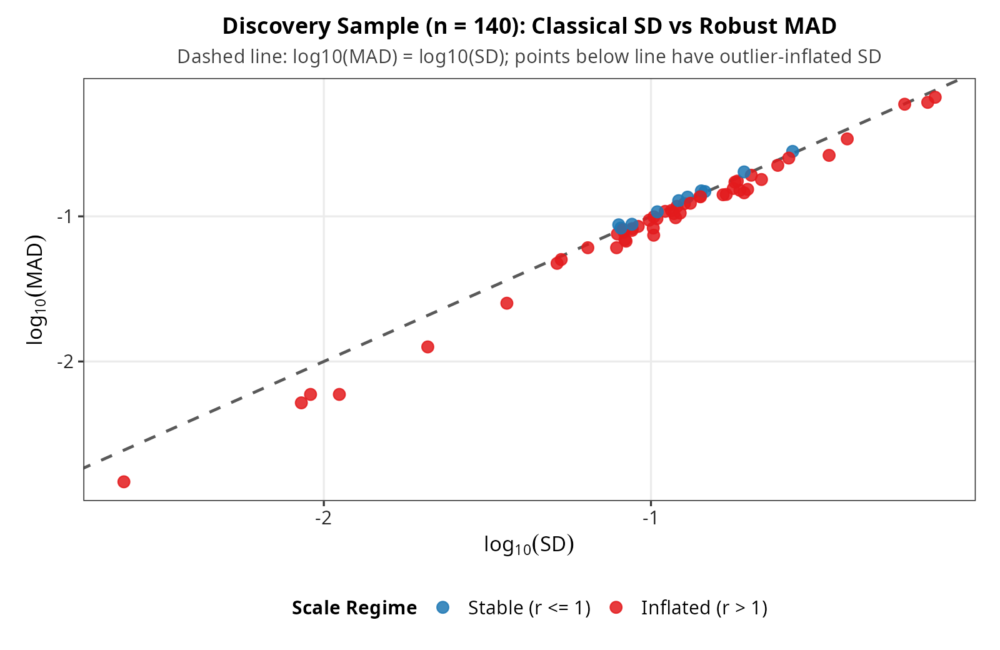
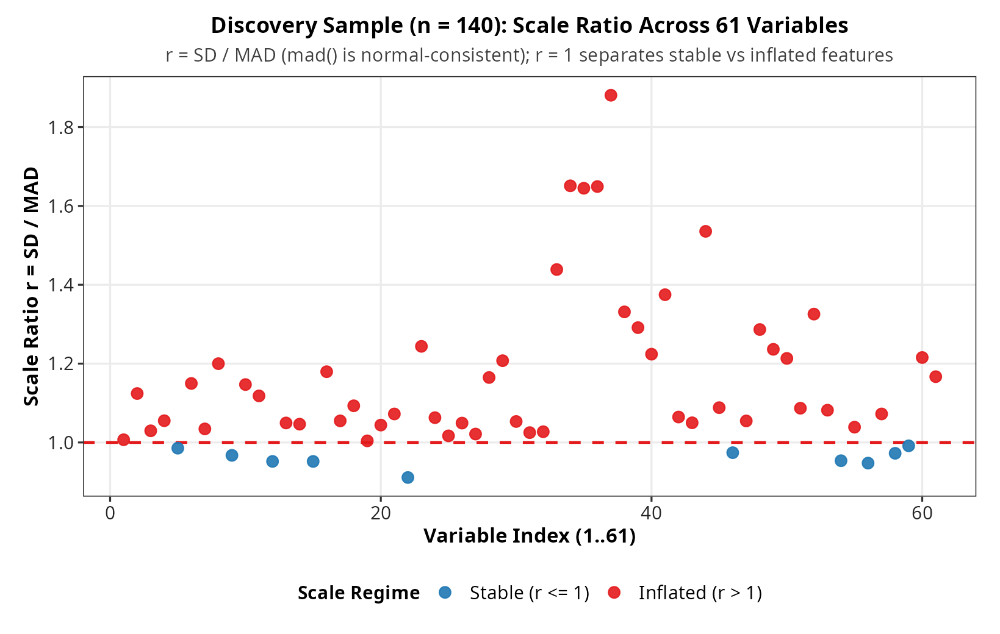
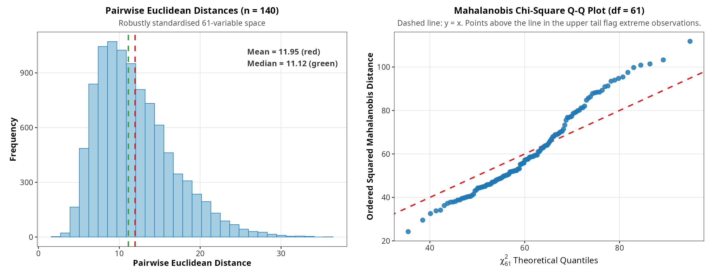
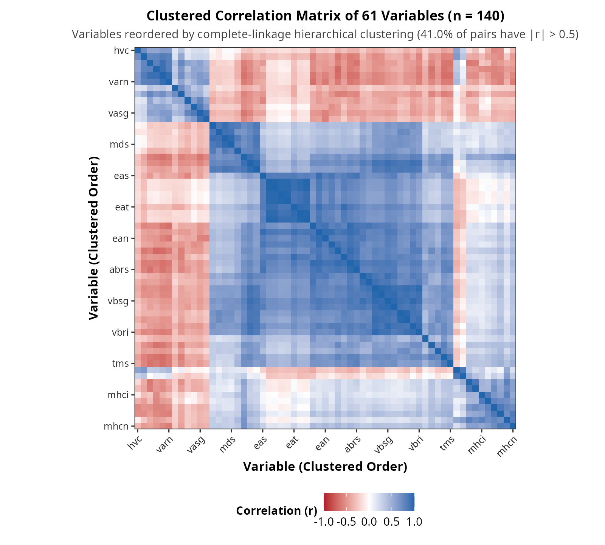
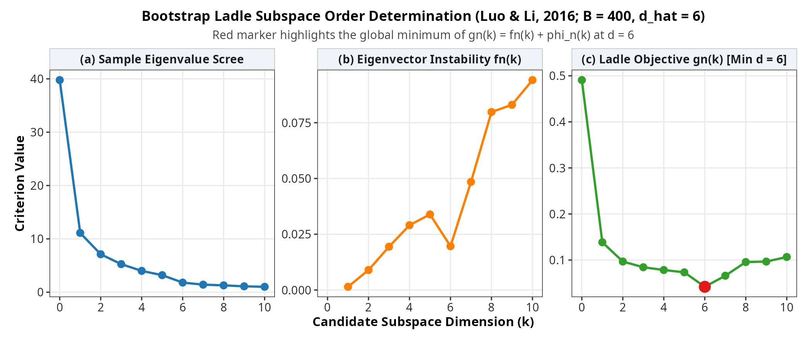
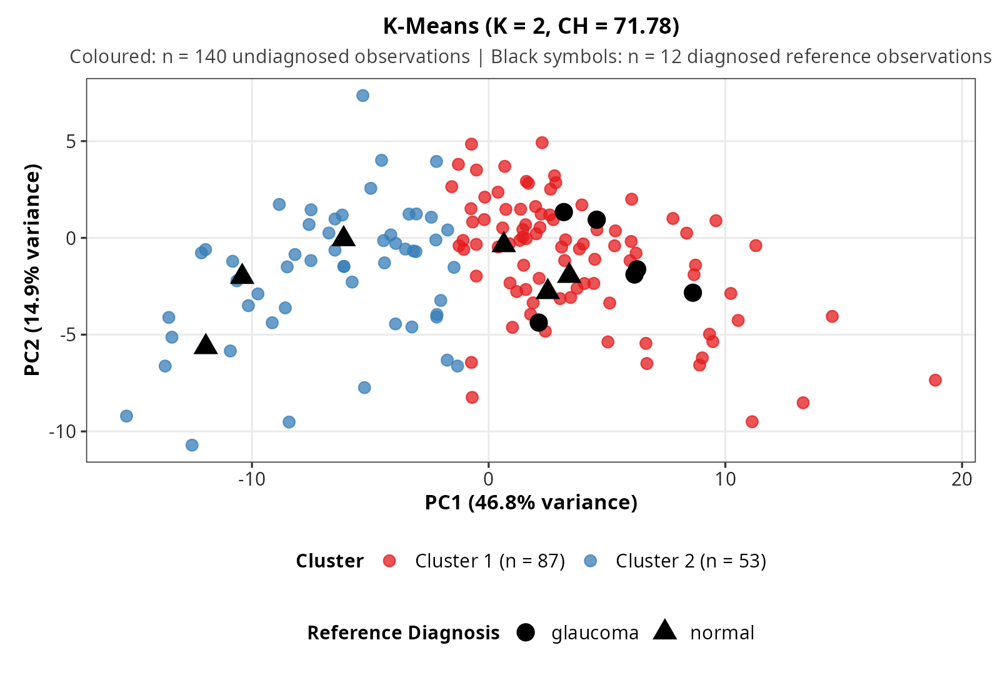
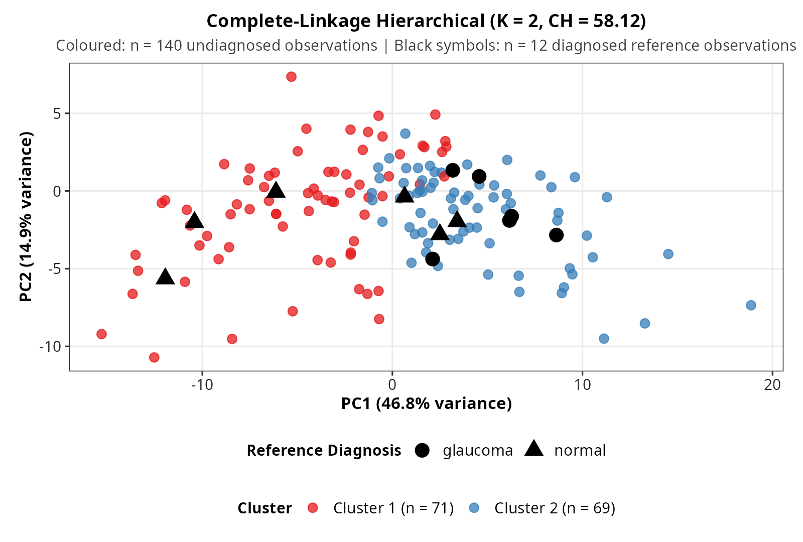
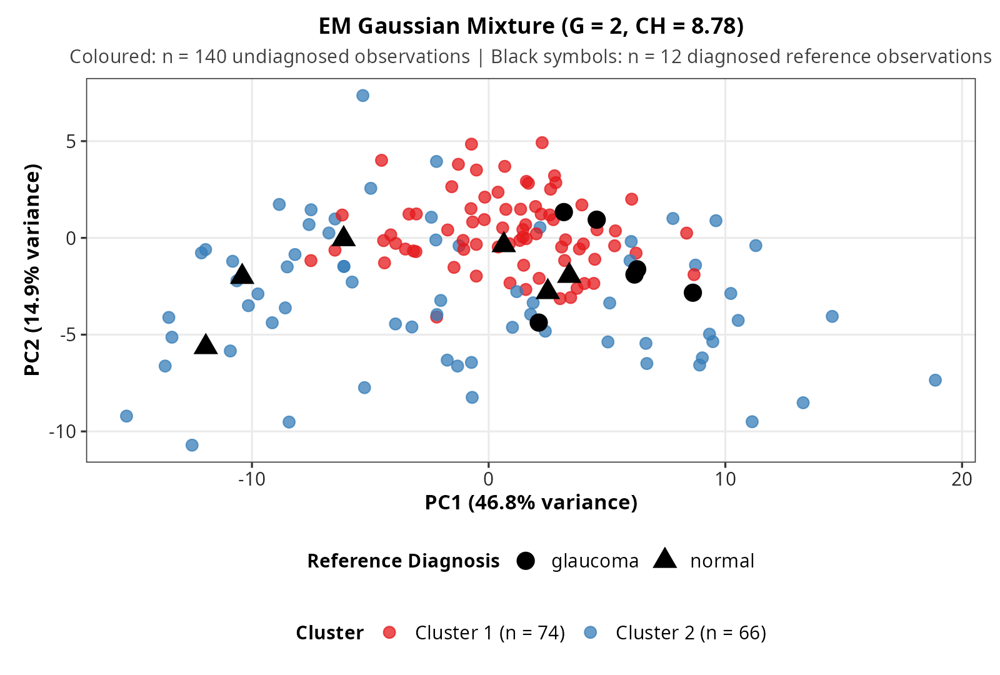
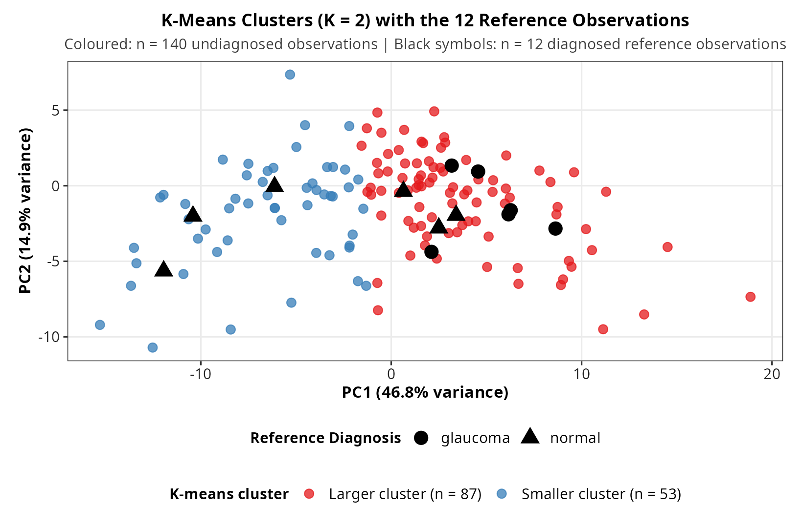
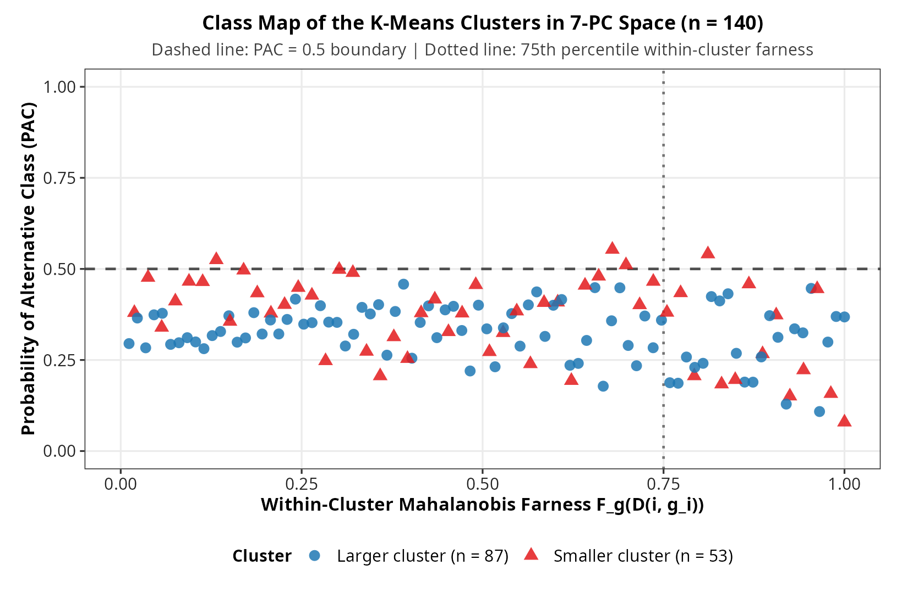

# Subspace Dimension Selection, Clustering, and Class Map Diagnostics for Glaucoma Eye-Examination Data

Glaucoma is a leading cause of irreversible optic neuropathy, characterised by progressive loss of retinal ganglion cell axons and cupping of the optic nerve head. The dataset analysed here contains variables obtained from an eye examination in which glaucoma is to be diagnosed. The source of the data, the measurement instrument, and the definitions of the individual variables are not documented, so the variables are treated simply as 61 numeric measurements.

In our dataset (`data/GlauData.txt`, not included in this repository; $n = 167$ observations across $p = 61$ variables), the diagnosis variable `Class` is available for only 12 reference observations (6 `glaucoma` and 6 `normal`) and is missing for the remaining 155 observations, which are therefore unlabelled. Training a supervised classifier on 12 observations in 61 dimensions ($n \ll p$) would overfit severely. At the same time, many of the 61 variables are strongly correlated (Section 2), and their empirical standard deviations span roughly a $300\times$ range ($302\times$ in the discovery sample, from $\min \text{SD} = 0.0024$ to $\max \text{SD} = 0.7394$; see Section 1), so clustering directly on the raw measurements would be dominated by high-variance features and redundant dimensions.

This study applies an unsupervised multivariate pipeline to the unlabelled discovery sample ($n = 140$): we scale features with the median and MAD, estimate the intrinsic subspace dimension using the bootstrap Ladle estimator (Luo & Li, 2016) and Kaiser's rule, compare K-means, complete-linkage hierarchical clustering, and Gaussian mixture models in the reduced PCA subspace, project the 12 diagnosed reference observations onto the fitted subspace, and describe cluster boundary cases with a class map (Raymaekers, Rousseeuw & Hubert, 2022).

## Data

The dataset (`data/GlauData.txt`, not included in this repository) has 167 rows and 62 columns, read with `read.table(..., header = TRUE)`:

- **61 numeric variables, none with a missing value.** 55 of them form 11 groups of five that share a stem and differ only in their final letter (`g`, `t`, `s`, `n`, `i`): `a*`, `ea*`, `abr*`, `mhc*`, `phc*`, `vbs*`, `vas*`, `vbr*`, `var*`, `md*`, and `tm*` (for example `ag`, `at`, `as`, `an`, `ai`). The other six are `hic`, `hvc`, `mr`, `rnf`, `mdic`, and `emd`.
- **`Class` (character).** `glaucoma` for 6 rows, `normal` for 6 rows, and missing (`NA`) for the other 155 rows.

The file contains no documentation of the variable definitions or of the data source, so the variable names are used as given.

## 1. Cohort Partitioning & Median/MAD Scaling (`R/preprocess.R`)

Let $X \in \mathbb{R}^{140 \times 61}$ denote the undiagnosed discovery sample (drawn with `set.seed(734985); sample(155, 140)`) and $X_{\text{ref}} \in \mathbb{R}^{12 \times 61}$ the held-out diagnosed observations with labels $y_{\text{ref}} \in \{\text{glaucoma}, \text{normal}\}^{12}$. The other 15 unlabelled observations are not used. Each variable is centred by its discovery median and scaled by its discovery MAD, using R's `mad()`, which already includes the normal-consistency constant 1.4826:

$$z_{ij}^* = \frac{x_{ij} - \mathrm{median}(x_{\cdot j})}{\mathrm{MAD}(x_{\cdot j})}, \qquad \mathrm{MAD}(x_{\cdot j}) = 1.4826\,\mathrm{median}_i\left|x_{ij} - \mathrm{median}(x_{\cdot j})\right|.$$

The same location and scale vectors from the discovery sample are used to transform the 12 reference observations. To check which variables have heavy tails or outliers that inflate the classical variance, we compute the scale ratio $r_j = \text{SD}_j / \text{MAD}_j$. Because the MAD above is already normal-consistent, $r_j \approx 1$ for Gaussian data. Values above 1 indicate heavy tails or skewness.

| Cohort | $p$ | $\min \text{SD}$ | $\max \text{SD}$ | $\max / \min \text{SD}$ | Stable ($r_j \le 1$) | Outlier-Inflated ($r_j > 1$) | $r_j < 0.5$ |
|---|---|---|---|---|---|---|---|
| Discovery sample ($n = 140$) | 61 | 0.0024 | 0.7394 | 302.04 | 10 | 51 | 0 |
| Complete cohort ($n = 167$) | 61 | 0.0024 | 0.7342 | 301.89 | 10 | 51 | 0 |

All observations are retained. Median/MAD scaling puts the variables on a common scale that is not itself inflated by outliers (unlike SD scaling), but it does not downweight the outliers themselves: heavy-tailed variables keep variance above 1 (the 61 variances of the scaled data sum to 82.42, compared with 61 under SD scaling) and therefore contribute more to distances and PCA than they would under SD scaling.





## 2. Multicollinearity & Mahalanobis Distance Geometry (`R/dimension.R`)

With $n = 140$ and $p = 61$ ($n/p \approx 2.30$), many of the variables are strongly collinear. Over 41% of all $\binom{61}{2} = 1830$ unique variable pairs have $|\rho| > 0.5$, and only 8 eigenvalues of the correlation matrix exceed 1. Correlations are invariant to the median/MAD scaling, so these counts apply to the raw and the scaled data alike.

| Cohort | $n$ | Pairs $\binom{61}{2}$ | Pairs $\|\rho\| > 0.5$ | % $\|\rho\| > 0.5$ | Pairs $\|\rho\| > 0.8$ | % $\|\rho\| > 0.8$ | $\lambda_{\max}(R)$ | $d_{\text{eff}}$ ($\lambda > 1$) | Condition Number $\kappa$ |
|---|---|---|---|---|---|---|---|---|---|
| Complete cohort | 167 | 1830 | 740 | 40.44% | 192 | 10.49% | 29.69 | 8 | $1.02 \times 10^8$ |
| Discovery sample | 140 | 1830 | 751 | 41.04% | 204 | 11.15% | 30.41 | 8 | $1.27 \times 10^8$ |

Plotting ordered squared Mahalanobis distances $D_i^2 = (z_i^{\ast} - \bar{z}^{\ast})^\top \hat{\Sigma}^{-1}(z_i^{\ast} - \bar{z}^{\ast})$, where $\hat{\Sigma}$ is the sample covariance matrix of the scaled data, against $\chi^2_{61}$ quantiles shows the lower tail below the $y = x$ line and the upper tail above it: the distances are more spread out than a $\chi^2_{61}$ predicts, and the largest few observations lie well above the line. This is not an estimation artefact. For Gaussian data and the sample covariance (divisor $n - 1$), $\frac{n}{(n-1)^2} D_i^2 \sim \mathrm{Beta}\!\left(\frac{p}{2}, \frac{n-p-1}{2}\right)$, and with $n = 140$, $p = 61$ this has a smaller spread than a $\chi^2_{61}$, so the observed excess spread points to heavy tails or outliers, consistent with the 51 outlier-inflated variables in Section 1. Redundancy among the variables ($\kappa \approx 1.3 \times 10^8$) makes $\hat{\Sigma}$ close to singular, so the distances are also sensitive to its smallest eigenvalues.





## 3. PCA on Median/MAD-Scaled Data & Bootstrap Ladle Estimator (`R/dimension.R`)

### Variance Explained & Out-of-Sample Projection

PCA is run on the median/MAD-standardised discovery matrix with `prcomp(..., center = FALSE)`, i.e. about the discovery median rather than the column means. This is classical PCA on robustly scaled data, not a robust PCA, so extreme observations can still influence the leading components. It concentrates 46.79% of total variance in PC1, 87.72% in the first 7 PCs, and 92.27% in the first 10 PCs. Mean-centring first gives nearly the same picture (PC1 48.26%, 87.66% in 7 PCs) and the same K-means cluster sizes. The 12 reference observations are scaled with the discovery median and MAD and then projected onto the same rotation.

| Component | PC1 | PC2 | PC3 | PC4 | PC5 | PC6 | PC7 | PC8 | PC9 | PC10 |
|---|---|---|---|---|---|---|---|---|---|---|
| Eigenvalue $\lambda_k$ | 39.80 | 12.68 | 7.29 | 5.65 | 4.04 | 3.22 | 1.94 | 1.42 | 1.32 | 1.12 |
| Variance (%) | 46.79% | 14.91% | 8.57% | 6.64% | 4.75% | 3.79% | 2.28% | 1.67% | 1.55% | 1.32% |
| Cumulative (%) | 46.79% | 61.70% | 70.27% | 76.91% | 81.65% | 85.44% | 87.72% | 89.40% | 90.95% | 92.27% |

These are eigenvalues of the second-moment matrix of the scaled discovery data about the discovery median, so the percentages are shares of a total of 85.06.

### Bootstrap Ladle Estimator (Luo & Li, 2016)

To supplement the cumulative variance threshold with a formal order estimator, `ladle()` implements the Ladle estimator of Luo & Li (2016, *Biometrika*). Let $B_k \in \mathbb{R}^{p \times k}$ be the leading $k$ sample eigenvectors and $B_{k,b}^*$ the leading $k$ eigenvectors from bootstrap sample $b = 1, \dots, B$ ($B = 400$). Subspace variability is measured via

$$f_{0,n}(k) = \frac{1}{B} \sum_{b=1}^B \left(1 - \left|\det\left(B_k^\top B_{k,b}^*\right)\right|\right), \qquad f_{0,n}(0) = 0,$$

and combined with the normalised eigenvalues $\phi_n(k)$ into the Ladle curve:

$$f_n(k) = \frac{f_{0,n}(k)}{1 + \sum_{i=0}^{k_{\max}} f_{0,n}(i)}, \qquad \phi_n(k) = \frac{\lambda_{k+1}}{1 + \sum_{i=0}^{k_{\max}} \lambda_{i+1}}, \qquad g_n(k) = f_n(k) + \phi_n(k).$$

The order estimate $\hat{d}$ depends on the choice of upper bound $k_{\max}$ through the normalising sums. Evaluating with $k_{\max} = 15$ ($B = 400$, seed 734985) yields $\hat{d} = 6$ ($g_n(6) = 0.0419$), while Kaiser's rule on the correlation matrix gives $d_{\text{eff}} = 8$. We retain 7 PCs for clustering as a compromise between the two (87.72% of cumulative variance); clustering on 6 PCs yields the same cluster sizes (87 and 53) and the same reference-observation counts per cluster. The Ladle uses the mean-centred sample covariance, so its eigenvalues differ from the PCA values above (second moments about the median) and its subspace is not exactly the one used for clustering; the mean-centred PCA check above gives the same cluster sizes.

| $k$ | 0 | 1 | 2 | 3 | 4 | 5 | 6 ($\hat{d}$) | 7 | 8 | 9 | 10 |
|---|---|---|---|---|---|---|---|---|---|---|---|
| $\lambda_{k+1}$ | 39.773 | 11.111 | 7.114 | 5.262 | 3.995 | 3.194 | 1.802 | 1.415 | 1.281 | 1.101 | 1.011 |
| $f_n(k)$ | 0.0000 | 0.0014 | 0.0090 | 0.0194 | 0.0291 | 0.0339 | 0.0196 | 0.0485 | 0.0798 | 0.0830 | 0.0941 |
| $g_n(k)$ | 0.4908 | 0.1385 | 0.0967 | 0.0843 | 0.0784 | 0.0733 | 0.0419 | 0.0659 | 0.0956 | 0.0966 | 0.1066 |



## 4. Clustering in the Reduced PCA Space & Reference-Observation Mapping (`R/clustering.R`)

### Internal Comparison (WSS, BSS, Calinski–Harabasz Index)

In the 7-PC subspace ($n = 140$), we compare K-means (`nstart = 50`), complete-linkage hierarchical clustering, and EM Gaussian mixture models (`mclust::Mclust`) for $K \in \{2, 3\}$ using within-cluster sum of squares (WSS), between-cluster sum of squares (BSS), and the Calinski–Harabasz index:

$$\text{WSS}(K) = \sum_{l=1}^K \sum_{i \in C_l} \|x_i - \bar{x}_l\|^2, \qquad \text{BSS}(K) = \sum_{l=1}^K n_l \|\bar{x}_l - \bar{x}\|^2, \qquad \text{CH}(K) = \frac{\text{BSS}(K)/(K - 1)}{\text{WSS}(K)/(n - K)}.$$

| $k$ | Method | WSS | BSS | CH Index |
| :---: | :--- | :---: | :---: | :---: |
| 2 | Hierarchical (Complete) | 7057.702 | 2972.303 | 58.118 |
| **2** | **K-means** | **6597.948** | **3432.057** | **71.784** |
| 2 | Gaussian Mixture (EM) | 9430.106 | 599.899 | 8.779 |
| 3 | Hierarchical (Complete) | 5987.318 | 4042.687 | 46.252 |
| **3** | **K-means** | **5207.868** | **4822.137** | **63.426** |
| 3 | Gaussian Mixture (EM) | 9168.243 | 861.762 | 6.439 |

K-means with $K = 2$ achieves the highest Calinski–Harabasz index ($71.784$), yielding clusters of 87 and 53 observations; complete-linkage hierarchical clustering yields 71 and 69, and EM mixture modelling yields 74 and 66. CH favours spherical Euclidean partitions, so it is not a like-for-like comparison with likelihood-based EM, whose hard-assigned split has very small between-cluster sum of squares (BSS is about 6% of the total). In the PC1–PC2 plane the two EM components appear as a compact central group and a more diffuse surrounding group, so the split seems to be driven by spread rather than by a shift in location, which is consistent with the small BSS.





### Out-of-Sample Mapping of the 12 Reference Observations

Each held-out observation is scaled with the discovery median/MAD, projected onto the 7-PC subspace, and assigned to its nearest K-means ($K = 2$) centroid.

| Cluster | Discovery Size ($n = 140$) | Reference Glaucoma ($n = 6$) | Reference Normal ($n = 6$) |
| :---: | :---: | :---: | :---: |
| Larger cluster | 87 | 6 (100%) | 3 (50%) |
| Smaller cluster | 53 | 0 (0%) | 3 (50%) |

All 6 reference glaucoma observations and 3 normal observations map to the larger cluster (87 discovery observations), while the remaining 3 normal observations and 0 glaucoma observations map to the smaller cluster (53 discovery observations). This is consistent with the larger cluster being the glaucoma-like group, but it is only suggestive: three normal observations also fall in it, and 12 labelled observations are far too few for a formal assessment (Fisher's exact test on this $2 \times 2$ table gives $p \approx 0.09$ one-sided and $p \approx 0.18$ two-sided).





## 5. Class Map (Descriptive Diagnostic) (`R/classmap.R`)

`classmap()` implements the class map idea of Raymaekers, Rousseeuw & Hubert (2022) on the same 7-PC scores, using the K-means clusters as class labels. For each observation, PAC (probability of the alternative class) measures how strongly it is pulled towards the other cluster, and farness ranks how far it lies from its own cluster relative to the other members of that cluster:

$$\mathrm{PAC}(i) = \frac{\tilde{p}(i)}{\hat{p}(i, g_i) + \tilde{p}(i)}, \qquad \tilde{p}(i) = \max_{g \ne g_i} \hat{p}(i, g), \qquad \mathrm{farness}(i) = \hat{F}_{g_i}\left(D(i, g_i)\right).$$

Here $\hat{p}$ comes from softmax-transformed least-squares scores, not calibrated posteriors, and the labels are derived from the same features, so the class map is purely descriptive: it shows which observations sit close to the cluster boundary and which are far from their cluster, and it is not an independent validation of the clustering. Absolute PAC values depend on the softmax scale, so only the relative ordering of observations should be read. Farness is computed as the empirical cumulative distribution function of the squared within-cluster Mahalanobis distances $D^2$ (each observation's distance to its own cluster mean, using that cluster's covariance matrix with a ridge of $10^{-6}$ added to the diagonal; a simplification of the original definition), so it is a within-cluster percentile: about 25% of each cluster has $\text{farness} > 0.75$ by construction, and it ranks observations rather than flagging outliers.

| Cluster | $n$ | Mean PAC | Boundary Cases ($\text{PAC} > 0.5$) | Far & Ambiguous ($\text{PAC} > 0.5, \text{farness} > 0.75$) |
|---|---|---|---|---|
| Larger cluster | 87 | 0.326 | 0 | 0 |
| Smaller cluster | 53 | 0.367 | 4 | 1 |

No observation in the larger cluster has $\text{PAC} > 0.5$. In the smaller cluster, 4 observations have $\text{PAC} > 0.5$, and 1 of them also has $\text{farness} > 0.75$.



## 6. Summary

Because of strong collinearity across the 61 measurements ($\kappa = 1.27 \times 10^8$, 41% of pairs with $|\rho| > 0.5$), most of the variance lies in a low-dimensional subspace ($\hat{d} = 6$ by the Ladle estimator, $d_{\text{eff}} = 8$ by Kaiser's rule, with 87.72% of variance in the first 7 PCs). In this 7-PC subspace, two-cluster K-means separates the 140 discovery observations into groups of 87 and 53 ($\text{CH} = 71.78$). Projecting the 12 diagnosed reference observations places all 6 glaucoma observations and 3 normal observations in the larger cluster and the remaining 3 normal observations in the smaller cluster, which suggests, but does not establish, that the larger cluster is glaucoma-like. The descriptive class map shows 4 observations near the cluster boundary, all in the smaller cluster.

## 7. Limitations

- The clusters have not been tested against a null of no cluster structure. PC1 holds about 47% of the variance and 51 of the 61 variables have SD/MAD > 1 (heavy tails or skewness), and K-means will split such a cloud into two groups, so $K = 2$ reflects the best CH among the $K$ values compared.
- The source and measurement protocol of the data are not documented, and PC1 may capture a general size or overall-magnitude factor shared by many correlated variables rather than disease status. Neither was examined, so the clusters are not interpreted in terms of specific measurements or anatomy.
- Only 12 observations carry a diagnosis, so the cluster labelling is suggestive and its uncertainty is large.
- PCA is run on median/MAD-scaled data and is not robust, so extreme observations can still influence the leading components.
- All results use a single random seed (734985) for the discovery sample, K-means, and the Ladle bootstrap, so other seeds could give different cluster sizes.

## Running the Code

All results are computed from `data/GlauData.txt` using the scripts in `R/` (`preprocess.R`, `dimension.R`, `clustering.R`, `classmap.R`) under R 4.3.3 with `mclust`, `ggplot2`, `RColorBrewer`, and `gridExtra`.

**The dataset is not included in this repository.** To reproduce the results, place your own copy of the file at `data/GlauData.txt` (a header row followed by the 62 columns described in the Data section, readable with `read.table("data/GlauData.txt", header = TRUE)`); the scripts read it from that path. The tables and figures in this README are static outputs from one run on that file. Sampling, K-means (`nstart = 50`), and the Ladle bootstrap ($B = 400$) all use `set.seed(734985)`.

Run the full analysis and regenerate all figures in `figures/` from the repository root:

```bash
Rscript glaucomaHrtAnalysis.R
```

Or run each step interactively in R:

```r
library(mclust)
for (f in c("preprocess", "dimension", "clustering", "classmap")) source(file.path("R", paste0(f, ".R")))

df       = read.table("data/GlauData.txt", header = TRUE)
cohort   = splitCohort(df)
std      = standardize(cohort$xDiscovery, cohort$xReference)
pca      = fitPca(std$zDiscovery, std$zNew, rankK = 7)
bench    = clusterBench(pca$scoresDiscovery)
km2      = bench$kmeansModels[["2"]]
map      = mapReference(pca$scoresDiscovery, km2$cluster, km2$centers,
                        pca$scoresReference, cohort$yReference)
cm       = classmap(pca$scoresDiscovery, factor(km2$cluster))
ladleFit = ladle(std$zDiscovery)
```

## References

- Luo, W., & Li, B. (2016). Combining Eigenvalues and Variation of Eigenvectors for Order Determination. *Biometrika*, 103(4), 875–887.
- Raymaekers, J., Rousseeuw, P. J., & Hubert, M. (2022). Class Maps for Visualizing Classification Results. *Technometrics*, 64(2), 151–165.
- Belsley, D. A., Kuh, E., & Welsch, R. E. (1980). *Regression Diagnostics: Identifying Influential Data and Sources of Collinearity*. Wiley.
- Hastie, T., Tibshirani, R., & Friedman, J. (2009). *The Elements of Statistical Learning* (2nd ed.). Springer.
